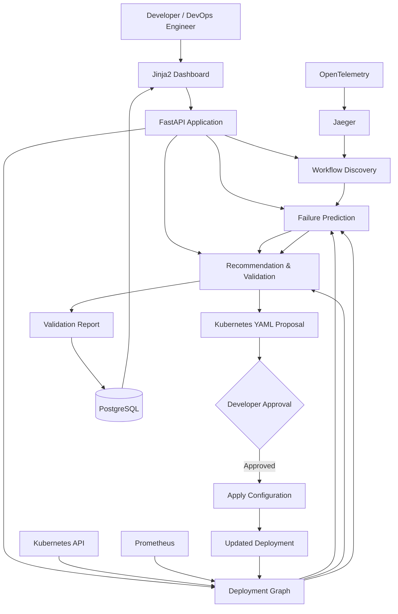

# K8s Resilience Engine

A dependency-aware resilience assessment and recommendation system for Kubernetes-deployed microservice architectures.

This research project combines business workflow dependencies, actual Kubernetes pod placement, failure-impact prediction, and recommendation validation to determine whether critical workflows can survive worker-node failures.

---

## Project Information

- **Project ID:** J26-SE-311
- **Research Area:** Software Systems & Technologies
- **Specialization:** Software Engineering
- **Research Topic:** Dependency Aware Failure Domain Risk Assessment for Kubernetes Deployed Microservice Architectures
- **Application Type:** Integrated full-stack FastAPI application
- **Frontend:** Jinja2, HTML, CSS, JavaScript
- **Backend:** FastAPI, Python
- **Database:** PostgreSQL

---

## Research Problem

Kubernetes supports replication, scheduling, readiness checks, affinity rules, topology spread constraints, and disruption handling. However, multiple replicas do not always guarantee that an end-to-end business workflow can survive a worker-node failure.

A service may have several replicas, but if all replicas are placed on the same worker node or failure domain, that service may become unavailable when the node fails. If the service is mandatory for important workflows such as checkout, payment, refund, or confirmation, several workflows may fail even when most other services remain healthy.

The project addresses the gap between:

```text
Kubernetes-level availability
            and
Business-workflow-level resilience
```

The system connects:

```text
Workflow → Service → Pod → Node → Failure Domain
```

It predicts service survival, workflow survival, and blast radius under worker-node failures, then recommends minimal deployment changes and validates whether the recommendations actually improve resilience.

---

## Main Objective

To design and experimentally evaluate a dependency-aware cross-layer risk assessment system that combines business workflow dependencies with Kubernetes pod placement to predict service survival, workflow survival, and blast radius under single worker-node failures, and to recommend minimal deployment changes that improve microservice workflow resilience.

---

## High-Level Architecture



---

# Team Responsibilities

The system is divided into four independently evaluatable research components.

---

## Member 1 — Workflow Discovery

### Member

- **Name:** A.D. Perera
- **Registration Number:** IT23236400
- **Component Folder:** `app/engine/workflow_dependency_modeling/`

### Main Responsibility

Identify and validate the mandatory service dependencies required for defined business workflows by combining workflow definitions with runtime distributed traces.

### Inputs

- Business workflow definitions
- Expected workflow success conditions
- OpenTelemetry traces
- Jaeger trace data

### Main Tasks

1. Define business workflows and expected success conditions.
2. Collect workflow knowledge from the benchmark application.
3. Execute workflows and collect distributed traces using OpenTelemetry.
4. Store and inspect traces using Jaeger.
5. Extract observed services, service interactions, and execution paths.
6. Compare observed runtime interactions with workflow requirements.
7. Classify service dependencies as:
   - Mandatory
   - Optional
   - Supporting
8. Construct workflow dependency graphs.
9. Compare generated graphs with reference workflow graphs.
10. Evaluate graph quality using:
    - Precision
    - Recall
    - F1-score
    - Edge-level accuracy
11. Export validated workflow graph JSON for Component 3.

### Expected Output

```json
{
  "workflowId": "checkout",
  "criticality": 0.9,
  "mandatoryServices": [
    "cartservice",
    "checkoutservice",
    "paymentservice"
  ],
  "optionalServices": [
    "emailservice"
  ],
  "edges": [
    {
      "from": "frontend",
      "to": "cartservice"
    },
    {
      "from": "cartservice",
      "to": "checkoutservice"
    },
    {
      "from": "checkoutservice",
      "to": "paymentservice"
    }
  ]
}
```

### Novelty

Combines business workflow definitions with runtime distributed traces to identify which service dependencies are truly mandatory for workflow completion instead of treating every observed trace interaction as equally critical.

### What Member 1 Should Do First

```text
1. Select 2–4 business workflows
2. Write expected workflow paths manually
3. Deploy the sample application
4. Add OpenTelemetry instrumentation
5. Send traces to Jaeger
6. Export sample traces
7. Build the first workflow graph
8. Compare it with the manual reference graph
```

---

## Member 2 — Deployment Graph and Placement Drift

### Member

- **Name:** P.A.M. Minara
- **Registration Number:** IT23154476
- **Component Folder:** `app/engine/deployment_topology_modeling/`

### Main Responsibility

Construct and validate a Kubernetes deployment-topology model that compares declared deployment intent with actual runtime pod placement to identify replica concentration, failure-domain exposure, and placement drift.

### Inputs

- Kubernetes manifests
- Kubernetes API
- Live cluster state
- Deployments
- ReplicaSets
- Services
- Pods
- Nodes
- Scheduling policies

### Main Tasks

1. Parse Kubernetes manifests.
2. Extract:
   - Declared replica counts
   - Selectors
   - Labels
   - Readiness probes
   - Node affinity
   - Pod anti-affinity
   - Topology spread constraints
3. Query live cluster state through the Kubernetes API.
4. Collect:
   - Pod phase
   - Pod readiness
   - Restart count
   - Node assignment
   - Owner references
   - Node and zone labels
5. Resolve the ownership chain:

```text
Service → Pod → ReplicaSet → Deployment → Node
```

6. Build the deployment-topology graph.
7. Detect service-level replica concentration.
8. Determine whether ready replicas share the same failure domain.
9. Calculate service-level worker-node exposure.
10. Compare declared intent with actual runtime placement.
11. Analyse placement drift during:
    - Initial deployment
    - Scale up
    - Scale down
    - Rolling update
    - Pod deletion and rescheduling
    - Node cordon
    - Node drain
12. Validate the Deployment Graph.
13. Export DeploymentGraph JSON for Components 3 and 4.

### Expected Output

```json
{
  "nodes": [
    {
      "name": "node-1",
      "zone": "zone-a",
      "cpuAvailable": 4,
      "memoryAvailable": 8
    },
    {
      "name": "node-2",
      "zone": "zone-a",
      "cpuAvailable": 4,
      "memoryAvailable": 8
    },
    {
      "name": "node-3",
      "zone": "zone-b",
      "cpuAvailable": 4,
      "memoryAvailable": 8
    }
  ],
  "services": [
    {
      "name": "paymentservice",
      "declaredReplicas": 3,
      "readyReplicas": 3,
      "replicaConcentration": 0.67,
      "pods": [
        {
          "name": "payment-1",
          "node": "node-1",
          "zone": "zone-a",
          "ready": true
        },
        {
          "name": "payment-2",
          "node": "node-1",
          "zone": "zone-a",
          "ready": true
        },
        {
          "name": "payment-3",
          "node": "node-2",
          "zone": "zone-a",
          "ready": true
        }
      ]
    }
  ]
}
```

### Novelty

Validates the gap between declared Kubernetes deployment intent and actual runtime pod placement by detecting replica concentration, quantifying service-level failure-domain exposure, and analysing placement drift under runtime changes.

### What Member 2 Should Do First

```text
1. Create a small three-node Kubernetes cluster
2. Deploy one sample microservice application
3. Query nodes and pods using the Kubernetes API
4. Resolve each pod to its owner Deployment
5. Build the first Service → Pod → Node JSON model
6. Calculate replica concentration
7. Run one pod deletion/reschedule test
8. Compare the before and after placement
```

---

## Member 3 — Cross-Layer Failure Prediction

### Member

- **Name:** K.V.D.Y.R. Karawita
- **Registration Number:** IT23236882
- **Component Folder:** `app/engine/failure_impact_prediction/`

### Main Responsibility

Predict service survival, workflow survival, and node-level blast radius using a cross-layer workflow-deployment model.

### Inputs

- Validated Workflow Graph from Member 1
- Validated Deployment Graph from Member 2

### Main Tasks

1. Combine Component 1 and Component 2 outputs.
2. Construct the cross-layer graph:

```text
Workflow → Service → Pod → Node → Failure Domain
```

3. Simulate worker-node failures.
4. Virtually remove all pods hosted on a selected failed node.
5. Calculate service survival.
6. Check whether each service still has at least one healthy replica.
7. Predict workflow survival.
8. Mark a workflow as surviving only when all mandatory services remain available.
9. Compute node-level blast radius.
10. Rank worker nodes by workflow disruption severity.
11. Identify:
    - Failed pods
    - Failed services
    - Failed workflows
    - Root causes
12. Generate Failure-Impact Reports in JSON.
13. Provide risk reports to Component 4.
14. Validate predicted failures using controlled Chaos Mesh experiments.

### Expected Output

```json
{
  "workflowId": "checkout",
  "riskLevel": "HIGH",
  "blastRadius": 60,
  "survivability": 40,
  "affectedServices": [
    "paymentservice"
  ],
  "failedWorkflows": [
    "checkout"
  ],
  "rootCauses": [
    {
      "type": "REPLICA_CONCENTRATION",
      "service": "paymentservice",
      "failureDomain": "node-1",
      "concentration": 0.67
    }
  ],
  "nodeRiskRanking": [
    {
      "node": "node-1",
      "blastRadius": 60
    }
  ]
}
```

### Novelty

Introduces a deterministic cross-layer graph simulation method that converts service-level deployment exposure into workflow-level failure-impact prediction by combining mandatory workflow dependencies with actual Kubernetes pod placement.

### What Member 3 Should Do First

```text
1. Load sample workflow JSON
2. Load sample deployment JSON
3. Build the cross-layer graph
4. Simulate one node failure
5. Remove pods on that node virtually
6. Recalculate surviving services
7. Recalculate surviving workflows
8. Compute blast radius
9. Export the first risk report
10. Compare the prediction with one real node-failure experiment
```

---

## Member 4 — Recommendation and Validation

### Member

- **Name:** L.A. Nemal
- **Registration Number:** IT23236264
- **Component Folder:** `app/engine/recommendation_evaluation_validation/`

### Main Responsibility

Develop a context-aware recommendation evaluation framework for improving Kubernetes deployment resilience.

### Inputs

- Failure-Impact Report from Member 3
- Deployment Graph from Member 2
- Workflow criticality and mandatory-service information
- Cluster capacity and scheduling constraints

### Main Tasks

1. Identify the risk context and root cause.
2. Generate multiple candidate recommendations using context-aware rules.
3. Create a virtual copy of the Deployment Graph.
4. Apply each recommendation to the virtual deployment.
5. Perform what-if simulation.
6. Evaluate feasibility.
7. Check:
   - Available nodes
   - CPU and memory capacity
   - Existing labels
   - Taints and tolerations
   - Affinity rules
   - Topology constraints
8. Recalculate predicted risk using the simulated deployment.
9. Estimate resilience improvement.
10. Estimate operational and resource cost.
11. Calculate a confidence score.
12. Rank recommendations using multiple metrics.
13. Select the best recommendation.
14. Generate Kubernetes configuration YAML.
15. Request developer approval.
16. Apply the approved configuration in the test environment.
17. Collect the updated Deployment Graph.
18. Obtain the recalculated actual risk.
19. Compare predicted and observed improvement.
20. Generate a final validation report.

### Core Candidate Recommendations

- Redistribute an existing replica
- Apply pod anti-affinity
- Add topology spread constraints
- Increase replica count when required
- Combine compatible recommendations

### Expected Output

```json
{
  "workflowId": "checkout",
  "recommendations": [
    {
      "id": "rec-001",
      "type": "TOPOLOGY_SPREAD",
      "service": "paymentservice",
      "feasible": true,
      "predictedBlastRadius": 15,
      "riskReduction": 45,
      "resourceCost": "LOW",
      "confidence": 0.88,
      "score": 0.86
    }
  ],
  "selectedRecommendationId": "rec-001"
}
```

### Validation Output

```json
{
  "recommendationId": "rec-001",
  "predictedBlastRadius": 15,
  "observedBlastRadius": 20,
  "predictionError": 5,
  "validated": true
}
```

### Novelty

Introduces a context-aware recommendation evaluation framework that combines cross-layer risk information, virtual what-if simulation, multi-criteria evaluation, and post-deployment validation to identify and verify the most effective resilience strategy.

Unlike static rule-based approaches, the framework does not stop after generating one recommendation. It generates several candidates, tests each candidate virtually, ranks them, and verifies whether the predicted improvement occurs after deployment.

### What Member 4 Should Do First

```text
1. Load sample Deployment Graph JSON
2. Load sample Failure-Impact Report JSON
3. Generate one topology-spread candidate
4. Create a virtual deployment copy
5. Move replicas virtually
6. Recalculate the predicted blast radius
7. Store before and after metrics
8. Add feasibility checking
9. Add a ranking formula
10. Add anti-affinity and replica-increase candidates
11. Generate Kubernetes YAML
12. Validate one approved recommendation in the test cluster
```

---

# Component Integration Contracts

The team must agree on shared JSON and Pydantic schemas before implementing full algorithms.

```text
Member 1 output
        ↓
WorkflowGraph

Member 2 output
        ↓
DeploymentGraph

WorkflowGraph + DeploymentGraph
        ↓
Member 3

Member 3 output
        ↓
FailureImpactReport

FailureImpactReport + DeploymentGraph
        ↓
Member 4

Member 4 output
        ↓
RecommendationReport + ValidationReport
```

---

## Shared Models

Shared models (implemented in `app/shared/schemas/`):

```text
app/shared/schemas/
├── base.py            # APIModel base (camelCase alias generator)
├── workflow.py
├── deployment.py
├── failure_impact.py
├── recommendation.py
└── validation.py
```

`app/shared/sample_loader.py` loads fixture JSON from `sample_data/` and validates it
against these schemas for the mock API routes.

No member should independently change these shared schemas without team agreement.

---

# Repository Structure

```text
k8s-resilience-engine/
│
├── app/
│   ├── __init__.py
│   ├── main.py
│   │
│   ├── api/
│   │   ├── health.py
│   │   ├── workflows.py
│   │   ├── deployments.py
│   │   ├── failure_impacts.py
│   │   ├── recommendations.py
│   │   └── validations.py
│   │
│   ├── templates/
│   │   ├── dashboard.html
│   │   ├── workflows.html
│   │   ├── deployments.html
│   │   ├── risks.html
│   │   ├── recommendations.html
│   │   └── validations.html
│   │
│   ├── static/
│   │   ├── css/
│   │   └── js/
│   │
│   ├── core/
│   │   ├── config.py
│   │   └── logging.py
│   │
│   ├── shared/
│   │   ├── enums.py
│   │   ├── sample_loader.py
│   │   └── schemas/
│   │       ├── base.py
│   │       ├── workflow.py
│   │       ├── deployment.py
│   │       ├── failure_impact.py
│   │       ├── recommendation.py
│   │       └── validation.py
│   │
│   ├── integrations/
│   │   ├── kubernetes/
│   │   │   ├── client.py
│   │   │   └── collector.py
│   │   ├── jaeger/
│   │   │   └── client.py
│   │   └── prometheus/
│   │       └── client.py
│   │
│   └── engine/
│       ├── workflow_dependency_modeling/
│       │   ├── service.py
│       │   ├── trace_parser.py
│       │   ├── dependency_classifier.py
│       │   ├── graph_builder.py
│       │   └── evaluator.py
│       │
│       ├── deployment_topology_modeling/
│       │   ├── service.py
│       │   ├── manifest_parser.py
│       │   ├── cluster_collector.py
│       │   ├── graph_builder.py
│       │   ├── concentration.py
│       │   └── drift_analyzer.py
│       │
│       ├── failure_impact_prediction/
│       │   ├── service.py
│       │   ├── cross_layer_graph.py
│       │   ├── node_failure_simulator.py
│       │   ├── service_survival.py
│       │   ├── workflow_survival.py
│       │   └── blast_radius.py
│       │
│       └── recommendation_evaluation_validation/
│           ├── service.py
│           ├── candidate_generator.py
│           ├── virtual_model.py
│           ├── simulator.py
│           ├── feasibility.py
│           ├── ranking.py
│           ├── yaml_generator.py
│           └── validation.py
│
├── tests/
│   ├── workflow_dependency_modeling/
│   ├── deployment_topology_modeling/
│   ├── failure_impact_prediction/
│   └── recommendation_evaluation_validation/
│
├── sample_data/
│   ├── workflow.json
│   ├── deployment.json
│   ├── failure_impact.json
│   ├── recommendation.json
│   └── validation.json
│
├── experiments/
│   ├── baseline/
│   ├── node_failures/
│   ├── placement_drift/
│   └── recommendation_evaluation_validation/
│
├── deploy/
│   └── kubernetes/
│
├── docs/
│   └── TAF-J26-SE-311.pdf
│
├── requirements.txt
├── .env.example
├── .gitignore
└── README.md
```

---

# Technology Stack

| Layer | Technology |
|---|---|
| Web application | FastAPI |
| Frontend | Jinja2, HTML, CSS, JavaScript |
| API schemas | Pydantic |
| Research algorithms | Python |
| Database | PostgreSQL |
| Cluster integration | Kubernetes Python Client |
| Distributed tracing | OpenTelemetry and Jaeger |
| Metrics | Prometheus |
| Failure injection | Chaos Mesh |
| Testing | Pytest |

---

# Development Phases

## Phase 1 — Shared Foundation

All members work together.

- Finalize folder structure
- Create FastAPI application
- Add Jinja2 templates
- Add shared schemas
- Create sample JSON files
- Create mock API routes
- Create a basic dashboard
- Agree on Git workflow

## Phase 2 — Independent Component Development

Each member develops using mock inputs.

```text
Member 1 → Workflow Discovery
Member 2 → Deployment Graph
Member 3 → Failure Prediction
Member 4 → Recommendation & Validation
```

## Phase 3 — Integration

Replace mock inputs one component at a time.

```text
Mock WorkflowGraph
        ↓
Real Member 1 output

Mock DeploymentGraph
        ↓
Real Member 2 output

Mock FailureImpactReport
        ↓
Real Member 3 output

Mock RecommendationReport
        ↓
Real Member 4 output
```

## Phase 4 — Experimental Validation

- Run controlled worker-node failures
- Compare predicted and observed service survival
- Compare predicted and observed workflow survival
- Measure blast-radius prediction accuracy
- Apply recommendations
- Compare before and after resilience
- Measure recommendation prediction error

---

# Immediate Team To-Do List

## All Members

- [ ] Confirm component folder names
- [ ] Approve shared JSON contracts
- [ ] Create Pydantic schemas
- [ ] Create sample JSON files
- [ ] Create component branches
- [ ] Agree on benchmark microservice system
- [ ] Agree on experiment metrics

## Member 1

- [ ] Define reference workflows
- [ ] Instrument the sample system
- [ ] Collect Jaeger traces
- [ ] Create first workflow graph
- [ ] Validate graph accuracy

## Member 2

- [ ] Connect to Kubernetes API
- [ ] Collect pods and nodes
- [ ] Resolve ownership chain
- [ ] Build first DeploymentGraph
- [ ] Calculate replica concentration
- [ ] Run first drift scenario

## Member 3

- [ ] Build cross-layer graph
- [ ] Simulate one worker-node failure
- [ ] Calculate service survival
- [ ] Calculate workflow survival
- [ ] Calculate blast radius
- [ ] Export first risk report

## Member 4

- [ ] Generate one candidate recommendation
- [ ] Create virtual deployment copy
- [ ] Simulate topology spread
- [ ] Add feasibility checking
- [ ] Calculate predicted improvement
- [ ] Rank candidates
- [ ] Generate YAML
- [ ] Validate predicted versus observed results

---

# Running the Application

## Create a virtual environment

```bash
python3 -m venv .venv
source .venv/bin/activate
```

Windows:

```powershell
.venv\Scripts\activate
```

## Install dependencies

```bash
pip install -r requirements.txt
```

## Run FastAPI

```bash
uvicorn app.main:app --reload
```

Open:

- Dashboard: `http://127.0.0.1:8000`
- API documentation: `http://127.0.0.1:8000/docs`
- Health endpoint: `http://127.0.0.1:8000/api/health`

---

# Planned API Endpoints

| Method | Endpoint | Owner |
|---|---|---|
| GET | `/api/health` | Shared |
| GET | `/api/workflows` | Member 1 |
| GET | `/api/deployments` | Member 2 |
| GET | `/api/failure-impacts` | Member 3 |
| POST | `/api/recommendations` | Member 4 |
| GET | `/api/validations` | Member 4 |

---

# Git Branches

Recommended branches:

```text
feature/workflow-discovery
feature/deployment-graph
feature/failure-prediction
feature/recommendation-validation
```

Shared changes should be reviewed before merging.

---

# Team Rules

- Do not change shared schemas without team agreement.
- Keep integration code separate from research algorithms.
- Add unit tests for each major function.
- Use mock data when another component is incomplete.
- Keep thresholds configurable.
- Document assumptions.
- Record all experiment configurations.
- Do not apply recommendations automatically without developer approval.
- Use pull requests for integration changes.

---

# Current Status

- [x] Complete system architecture agreed
- [x] Shared repository created
- [x] Folder structure finalized
- [x] FastAPI and Jinja2 skeleton completed
- [x] Shared schemas completed
- [ ] Sample JSON files completed (only `workflow.json` so far)
- [x] Mock API routes completed
- [x] Dashboard prototype completed
- [ ] Member 1 component completed
- [ ] Member 2 component completed
- [ ] Member 3 component completed
- [ ] Member 4 component completed
- [ ] Full integration completed
- [ ] Controlled experiments completed
- [ ] Final validation completed

---

# Research Positioning

This project is not intended to replace the Kubernetes scheduler.

It acts as an independent dependency-aware analysis and validation layer that:

- Observes actual runtime placement
- Connects deployment state with business workflows
- Predicts workflow-level failure impact
- Simulates resilience improvements before deployment
- Produces explainable Kubernetes recommendations
- Validates whether predicted improvements occur after deployment

---

## Contributors

| Member | Registration Number | Component |
|---|---|---|
| A.D. Perera | IT23236400 | Workflow Discovery |
| P.A.M. Minara | IT23154476 | Deployment Graph and Placement Drift |
| K.V.D.Y.R. Karawita | IT23236882 | Cross-Layer Failure Prediction |
| L.A. Nemal | IT23236264 | Recommendation and Validation |
