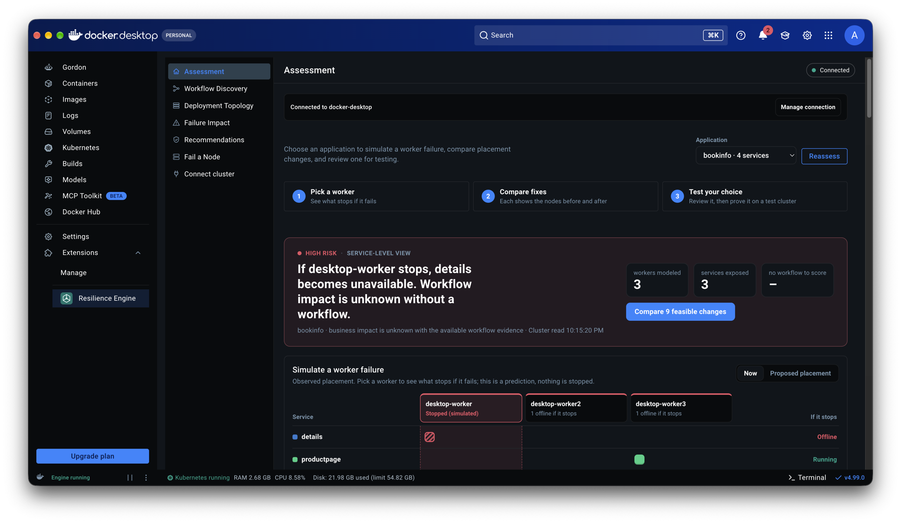
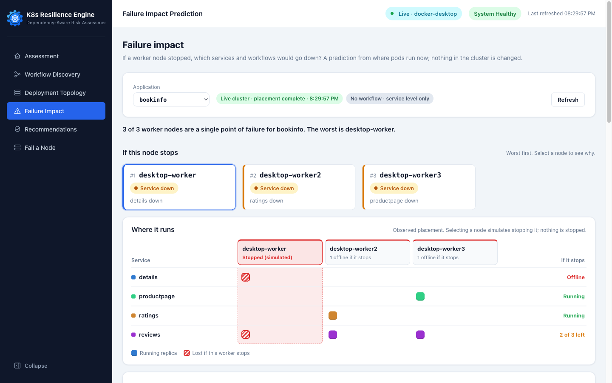

# K8s Resilience Engine

**A Docker Desktop extension that shows which of your services go down when a Kubernetes worker node fails, recommends placement changes, and lets you test them safely.**

Open it inside Docker Desktop, connect your local Kubernetes cluster, and see where every replica really runs, what a node failure would take down, and what to change. Nothing is applied and no node is stopped without you approving exactly what will happen.





## What you get

- **Failure impact**: for every worker node, which services lose all their ready replicas if it stops. Read-only, calculated from the pods running now.
- **Deployment topology**: services, pods, nodes and where replicas are concentrated.
- **Workflow discovery**: declare or review how your services depend on each other so results speak about business workflows, not only services.
- **Recommendations**: ranked changes (topology spread, extra replicas, anti-affinity) with the predicted improvement. Each is labelled as a prediction until you test it.
- **Apply and Reset**: apply an approved change to the connected cluster and put the previous state back, with the rollout watched and the effect re-measured.
- **Fail a Node**: stop chosen worker nodes on purpose, hold them for a time you choose, restore them, and read a measured report of what your application did.

## Install

Requires Docker Desktop with extensions and Kubernetes enabled.

```bash
docker extension install aseshnemal/k8s-resilience-engine:0.1.0-beta.3
```

Because this beta is not in the Docker Marketplace, first untick **Settings → Extensions → "Allow only extensions distributed through the Docker Marketplace"** (on a managed computer this setting may be locked by your administrator). Then open **Resilience Engine** in the Docker Desktop sidebar and choose **Connect cluster**.

```bash
docker extension update aseshnemal/k8s-resilience-engine:<new tag>   # update
docker extension uninstall aseshnemal/k8s-resilience-engine          # remove
```

Images are multi-architecture (`linux/amd64`, `linux/arm64`). There is no `latest` tag during the beta: always name the version.

## Release details

| Version | Notes |
| --- | --- |
| `0.1.0-beta.3` | Fail a Node shows the truth while a test runs: stopped workers are drawn as stopped (Kubernetes takes about a minute to notice), with a plain banner that has Restore now in it, and a short summary of what happened with the next step directly under it. Clearer Workflow Discovery, Recommendations and Deployment Topology screens, and the extension icon is now the product logo. |
| `0.1.0-beta.2` | Image metadata (version, source, documentation, license labels), license and third-party notices at `/licenses/` inside the image, and this overview. Same extension as beta.1. |
| `0.1.0-beta.1` | First public beta. |

Each image carries its source commit in the `org.opencontainers.image.revision` label, so any tag can be traced to the exact code it was built from.

## Safety and permissions

- **You approve every change.** Apply, Reset and Fail a Node each show exactly what will happen first. Stopping nodes on your everyday cluster needs an extra explicit confirmation, nodes of the control plane are never stopped, and essential workloads must be accepted by name.
- **Stopped nodes are restored** when the hold ends, when you press Restore, and after a restart of the extension.
- **Access to your cluster is full** (`*/*/*` on the connected cluster) so Apply and Reset can write. The extension writes only through the approved Apply/Reset path and the node test you start.
- **Nothing leaves your computer.** The backend listens on a Unix socket only (no published port). The cluster credential and results live in a Docker volume owned by the extension, not in the image.
- Docker access for the node test goes through a separate, restricted proxy container that can only touch the worker containers of the clusters it is configured for.

## Status

`0.1.0-beta.3` is a public beta. It is verified on macOS (Apple silicon) with Docker Desktop's Kubernetes. The Windows and Linux builds are tested in CI but have not yet been run on real machines. Fail a Node has so far been run for real only on the author's own cluster, so start with one worker and a short hold. Please report problems at https://github.com/AseshNemal/k8s-resilience-engine/issues.

## Links

- Source and issues: https://github.com/AseshNemal/k8s-resilience-engine
- Install and troubleshooting guide: https://github.com/AseshNemal/k8s-resilience-engine/blob/main/docs/EXTENSION.md

## License

Copyright 2026 K8s Resilience Engine Contributors. Licensed under the Apache License, Version 2.0. The license, `NOTICE` and third-party notices are inside the image at `/licenses/`.
